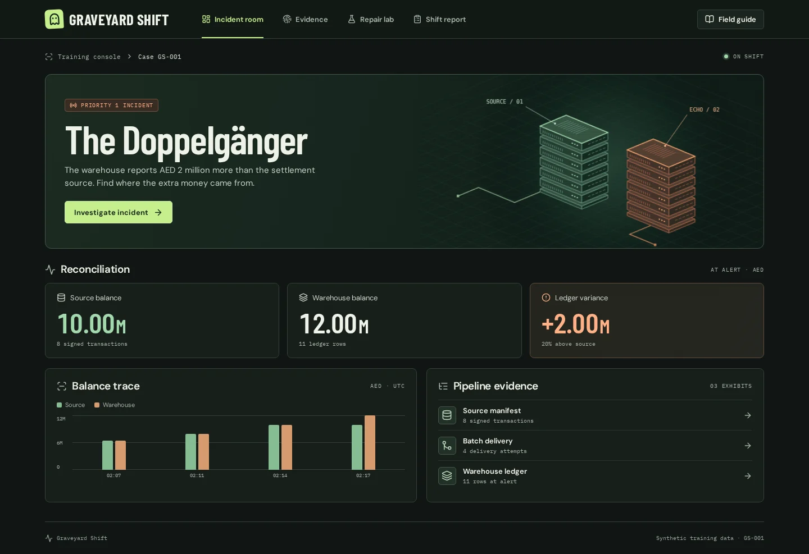

# Graveyard Shift

Graveyard Shift is a browser game for practising data engineering incident response. In **The Doppelgänger**, eight synthetic settlement instructions total AED 10 million. The published ledger reports AED 12 million. Inspect the records, write a SQL repair and prove that the repaired ledger survives another delivery.

[Play Graveyard Shift on GitHub Pages](https://moamryehia.github.io/graveyard-shift/)



## Play locally

Install Node.js 22.12 or newer. From the project directory, run:

```sh
npm ci
npm run dev
```

Open the local URL printed by Vite. Choose **Investigate incident** to open the source manifest, delivery journal and warehouse ledger. Pin records to cite in your handover. In **Repair lab**, run the starter query to reproduce the discrepancy, change the projection, then select **Verify replay**. The **Field guide** has three progressive clues.

The core case runs in your browser without credentials. DuckDB-Wasm, its worker, fonts and artwork ship with the build. The SQL engine loads when you first run a projection. Your browser saves the draft, pins, hints and last verified result locally. The **Shift report** exports a Markdown handover.

## Replay contract

The lab accepts a single SQL projection over `deliveries`. Output columns are `transaction_id` and `amount_fils`. One AED is 100 fils. Other input columns are `batch_id`, `attempt` and `arrival_seq`. Supported operations include `DISTINCT`, `GROUP BY`, `WHERE` and `QUALIFY ROW_NUMBER()`. Each run gets its own connection and temporary table. The verification compares transaction IDs and amounts, including their multiplicity.

| Probe | What a correct projection preserves |
| --- | --- |
| Incident at 02:17 UTC | The eight original transactions, totalling AED 10 million. |
| Two additional retries | The same eight transactions and the same total after 17 delivered rows. |
| A new transaction first seen on a retry | Nine distinct transactions totalling AED 10.6 million. The control shares an amount with an earlier transaction. |

## Build and test

```sh
npm run build
npm run preview
npx playwright install chromium
npm test
```

`dist/` can be served at the root or a repository subpath by a static HTTP server. The tests run the production build in Chromium and cover the full investigation, export, session restore, false-positive repairs, SQL errors and mobile navigation. To use an installed Chromium binary, set `CHROMIUM_PATH` to its absolute path before `npm test`.

## Optional live AI mentor

The field guide works locally. To enable an additional Bedrock explanation, run the FastAPI service with an AWS identity that can invoke a Converse-compatible model in your region. The service sends the selected synthetic exhibit and keeps AWS credentials on the server.

```sh
python3 -m venv .venv
. .venv/bin/activate
python -m pip install -r mentor/requirements.txt
export GRAVEYARD_BEDROCK_MODEL_ID='your-accessible-model-or-inference-profile'
export AWS_REGION='your-aws-region'
python -m uvicorn mentor.app:app --host 127.0.0.1 --port 8000
```

From a second terminal:

```sh
GRAVEYARD_MENTOR_ORIGIN=http://127.0.0.1:8000 VITE_LIVE_MENTOR=true npm run dev
```

Open a clue and choose **Ask the live AI mentor**. For a hosted build, set `VITE_LIVE_MENTOR=true` at build time and route `api/mentor` under the application path to the FastAPI endpoint. The default static build leaves this integration off. The service tests use a stubbed model client:

```sh
python -m pip install httpx
python -m unittest discover -s mentor -p 'test_*.py'
```

## Kiro workspace

The root `.kiro/` folder contains case requirements, design, implementation tasks, steering and a file-save hook that runs the case suite after changes to the simulation. Install the Playwright browser once before enabling the hook.

The initial implementation was developed with Codex. Kiro workspace files are prepared for a live Kiro session. A useful next task in Kiro is to extend the verifier to choose different retry counts and capture a real example of a regression the hook detects.

## Licence

Original project code and artwork are available under the MIT License. The npm packages and bundled fonts retain their own licences.
